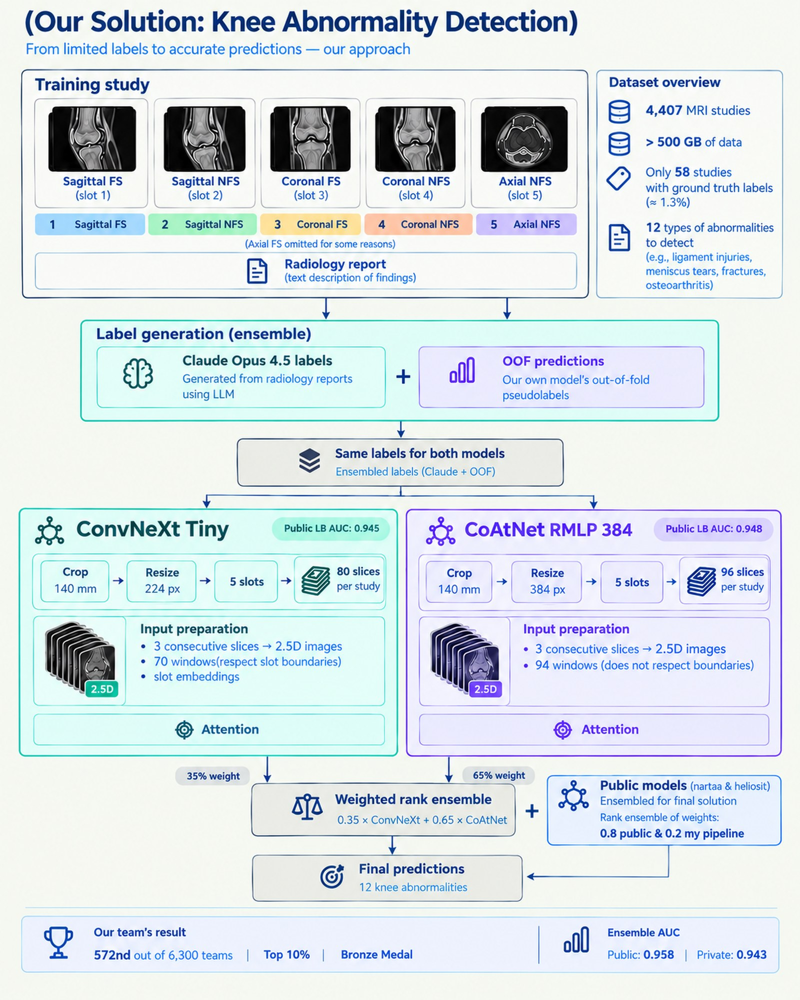

# RSNA 2026 Knee Abnormality Detection

Multi-label classification of knee MRI studies for the **[RSNA 2026 Knee Abnormality Detection](https://www.kaggle.com/competitions/rsna-knee-abnormality-detection)** Kaggle competition ([rules](https://www.kaggle.com/competitions/rsna-knee-abnormality-detection/rules)).

🥉 **Bronze medal: 572nd of 6,300 teams (top 10%)**
Final ensemble: **0.958 public / 0.943 private** macro ROC-AUC.

---

## Task

Each sample is one knee MRI study (several DICOM series in different planes and sequences). The model predicts **12 independent abnormality probabilities** per study:

| Group | Findings |
|---|---|
| Ligaments | ACL, MCL |
| Menisci | Medial Meniscus, Lateral Meniscus |
| Osteoarthritis | Medial OA, Lateral OA, PF OA |
| Soft tissue / fluid | Effusion, Synovitis, Baker's cyst |
| Bone | Contusion, Fracture |

- **Metric:** macro ROC-AUC across the 12 findings
- **Format:** code competition, internet off
- **Main challenge:** only **58 of 4,407** training studies (about 1.3%) have ground-truth labels, and the data is over 500 GB

---

## Approach

### 1. Labels from radiology reports
Because ground-truth labels are scarce, training labels were built in two layers:

1. **LLM-derived soft labels:** radiology reports converted into per-finding probabilities with Claude Opus 4.5. A hedged report ("tear suspected") becomes a value near 0.8 rather than a hard 1.
2. **Out-of-fold (OOF) pseudo-labels:** predictions from our own models, ensembled with the LLM labels.

The same ensembled labels were used to train both of our models. The 58 gold studies are used only for validation and are never trained on.

### 2. Preprocessing: 5-slot study volumes
Every study is reduced to a fixed layout of five series "slots":

| Slot | Plane | Sequence |
|---|---|---|
| 1 | Sagittal | Fluid-sensitive (FS) |
| 2 | Sagittal | Non-fluid-sensitive (NFS) |
| 3 | Coronal | FS |
| 4 | Coronal | NFS |
| 5 | Axial | NFS |

Slices are selected per slot, intensity-windowed (2nd–98th percentile), and center-cropped to **140 mm** using DICOM pixel spacing.

### 3. Models: 2.5D windows + attention
Both models stack **three consecutive slices as RGB channels** (a 2.5D window), encode each window with a timm backbone, then combine window features with an attention-based head to produce 12 logits. Training uses soft labels with BCE-with-logits and class-balancing `pos_weight`.

| | ConvNeXt-tiny (end-to-end) | CoAtNet-RMLP 384 (RAPTOR r4pool) |
|---|---|---|
| Crop / resolution | 140 mm / 224 px | 140 mm / 384 px |
| Slots | 5 | 5 |
| Slices per study | 80 (22 / 18 / 15 / 10 / 15 per slot) | 96 |
| Windows per study | 70, respecting slot boundaries | 94, not respecting slot boundaries |
| Head | Transformer over all windows with slot + slice-position embeddings, then per-finding attention pooling | MIL attention |
| Gold macro-AUC | 0.9267 (SWA over epochs 12–14) | – |
| Public LB (alone) | 0.945 | 0.948 |

Notes:
- Horizontal-flip augmentation is avoided in training because it swaps medial and lateral anatomy and changes the label meaning.
- The ConvNeXt model was trained in two phases: a frozen backbone with a transformer head on cached features, then end-to-end fine-tuning with optional series-shared augmentation.
- Checkpoints are averaged over the top epochs (SWA-style) for the final weights.

### 4. Final ensemble
1. **Our two models** are rank-blended: **0.35 × ConvNeXt-tiny + 0.65 × CoAtNet-RMLP 384**.
2. That result is rank-blended with the public models (nartaa and heliosli) at roughly **0.8 public / 0.2 our pipeline**. In the final notebook the exact weights are **0.825 / 0.175**.

All blend weights are fixed rank-blend weights, not fitted on labels.

---

## Results

| Submission | Public LB | Private LB |
|---|---|---|
| Final ensemble (selected) | 0.958 | 0.943 |
| Alternative candidate (not selected) | – | 0.944 |

---

## Early baseline (training notebook)

`convnext.ipynb` contains an early single-model baseline: CoAtNet-1 (224 px) with a per-finding attention-MIL head, trained on the soft labels with 12 windows per study (24 at evaluation). Settings: AdamW, OneCycleLR, backbone LR `3e-5`, head LR `1e-3`, fp16.

Gold macro-AUC by epoch for that run:

| Epoch | 0 | 2 | 4 | 6 | 9 | 12 (best) |
|---|---|---|---|---|---|---|
| Gold macro-AUC | 0.731 | 0.800 | 0.854 | 0.876 | 0.883 | 0.883 |

Weight averaging and an epoch-ensemble over the top 3 epochs lifted it to about 0.885–0.886.

---

## Usage

These notebooks run on Kaggle (T4 GPU, internet off for scoring).

1. Attach the [competition data](https://www.kaggle.com/competitions/rsna-knee-abnormality-detection/data) and the model-weight datasets referenced at the top of each notebook.
2. Run `rsna-knee-version2.ipynb` to reproduce the final blend. It writes `submission.csv` with one row per `StudyInstanceUID` and 12 probability columns.
3. For the baseline, run `convnext.ipynb` to train, then `convnext-inference.ipynb` to score.

> Inference preprocessing must reproduce the corpus builder used in training (slot layout, crop size, slice spans). Verify on a train study before trusting a submission.

**Requirements:** Python 3.12, PyTorch, timm, pydicom, OpenCV, NumPy, pandas, scikit-learn.

---

## Lessons learned

- **Trust validation over the public leaderboard.** Cross-validation pointed to a stronger final pick than the one chosen from the public LB.
- **Report-derived labels and pseudo-labeling** were the biggest levers when ground-truth labels are this scarce.
- **Build one strong single model first,** then ensemble. A baseline-first approach kept changes measurable.

---

## Credits and acknowledgements

- RSNA and Kaggle for the competition and data, used under the [competition rules](https://www.kaggle.com/competitions/rsna-knee-abnormality-detection/rules).
- **Team:** Chikonzero Selemani (ConvNeXt-tiny end-to-end model, label pipeline, write-up) and **Bala Manikandan** (RAPTOR r4pool model and the final blend notebook).
- Public work this solution builds on:
  - [dreaddevelopment](https://www.kaggle.com/datasets/dreaddevelopment/raptor-knee-widedense): Raptor CoAtNet/MIL inference recipe and baseline weights
  - [nartaa](https://www.kaggle.com/code/nartaa/rsna-knee-0949-anatomical-mirror) and [nartaa's 224 crop notebook](https://www.kaggle.com/code/nartaa/rsna-knee-0945-efficient-224crop): public Raptor 384 and 224 models
  - [varshithakolupuri](https://www.kaggle.com/code/varshithakolupuri/rsna-knee-one-unused-checkpoint-lifts-the-0-956): the 224-pixel stage and its share of the Raptor half
  - heliosli: the public blend notebook this final notebook forks
  - Weak-label sources: [stevenleehans](https://www.kaggle.com/datasets/stevenleehans/rsna-knee-llm-report-labels), [pilkwang](https://www.kaggle.com/datasets/pilkwang/rsna-knee-llm-labels), [riadmohamed42](https://www.kaggle.com/code/riadmohamed42/jev-knee-labels-verification)
  
